# EffiSend — Agentic Payments for High-Traffic Venues

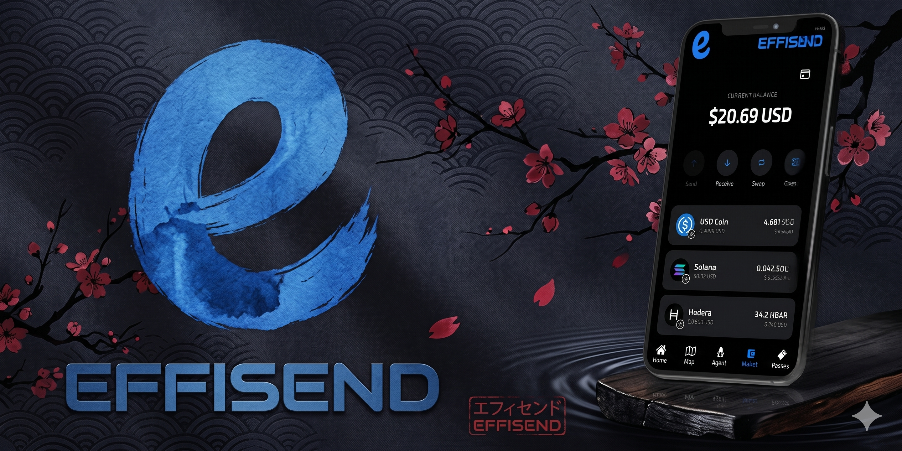

> A mobile-first crypto wallet and AI concierge that lets anyone receive, swap, bridge, and spend digital assets across 5 blockchains — verified by face, secured by PIN, guided by an AI agent that speaks your language.

**Platform:** Solana Seeker  
**Channel:** Solana dApp Store  
**Primary Network:** Solana  
**Stack:** Expo 54 · React Native · `@solana/kit` · Metaplex · Jupiter API · Ethers.js

---

## Live: the Pudgy Penguins Pop-Up at Tokyo Dome City


From **September 24 to October 2, 2026**, EffiSend was the crypto payment app of the **Pudgy Penguins Pop-Up** at enXross DAO, Tokyo Dome City, run with Fracton and enXross. Real visitors bought real merchandise with stablecoins, and **Solana carried most of it**.


### The results

| | Whole pilot | On Solana |
|---|---|---|
| Payments | **24** | **13** (54%) |
| Amount paid | **$678.43** | **$435.69** (64%) |
| Largest payment | $110.02 | $110.02 (USDC) |
| New users (face ID + PIN) | **26** | |
| App visits | **225** | |
| Effi NFTs given | **27** | 3 compressed NFTs |

- **USDC on Solana was the top payment method:** 11 payments for $420.91, almost two thirds of everything sold. The other 2 Solana payments were in SOL.
- **Opening day was the event:** 16 of the 24 payments and 21 of the 26 sign-ups happened on September 24. 14 of those 16 payments came in the evening, between 18:00 and 22:00.
- **Every payment is public:** each one is a direct on-chain transfer into the shop's receive-only wallet. For example, the largest one: [110.02 USDC on Solscan](https://solscan.io/tx/3EpHsgSG7XRRkSKrnExQQb1LA34WEDzWhZgfdBdZ1cpy3BYAnjMQMV6BkdRyMzZxics15JZtXoSEgXru4qnbjZUR).

The figures count only real customer payments: test transfers, dust, spam tokens, swaps and the team's own transfers are left out.

### How visitors paid with Solana

1. **Face ID.** The visitor opens EffiSend and scans their face. A new visitor gets a wallet on the spot and sets a PIN. No seed phrase, no extension, no app store download.
2. **PIN and amount.** They confirm with their PIN and enter the price in USD.
3. **On-chain in about 2 seconds.** The app sends the USDC straight to the shop's wallet. Each transaction goes to 3 Solana RPCs at once, and payments confirmed in about 2 seconds.

Visitors who already had a Solana wallet paid with **[Solana Pay](#payments-solana-pay-that-any-wallet-can-confirm)** instead: they scanned the QR from their own wallet, and the app found the payment on-chain by its reference key. 9 of the Solana payments went through the face-ID flow and 4 through Solana Pay.

### What the pilot proved, and what we improved

- **Stablecoins work at a real counter.** Prices stay in dollars, there is no card network in the middle, and the shop receives the money directly.
- **No single point of failure.** During the busiest afternoon, some Solana RPC connections failed or hit rate limits. The app switched to the next RPC automatically and the payments went through. Sending each transaction to several RPCs at once is now the default.
- **Gas fees are the real friction.** A few visitors held USDC but not enough SOL for the network fee, so their payment stopped before it was sent and nothing was charged. Next step: sponsored, gasless payments, so a stablecoin balance is all a visitor needs.
- **Next in Japan:** a crypto vending machine that takes the payment and dispenses the product on its own, plus new collaborations with partner brands and venues.

---

## The Problem

Crypto payments at high-traffic real-world venues are broken. You have tokens, no idea which account has enough balance, and no fast way to prove who you are without hardware wallets or browser extensions. The cashier is waiting. The queue is growing. The moment is gone.


> **EffiSend was built for Tokyo Dome City — but the architecture is designed for any high-traffic, real-world venue where speed and identity.**

Football stadiums, concert halls, theme parks, transit hubs — anywhere tens of thousands of people need to transact quickly and trustlessly.

---

## How It Works — The Big Picture

EffiSend's architecture is divided into three core pillars that work in harmony to provide a seamless venue experience.

### 1. Wallet Services (Identity & Assets)
The foundation of EffiSend is a biometric-first, non-custodial wallet that abstracts away seed phrases and complex setups.

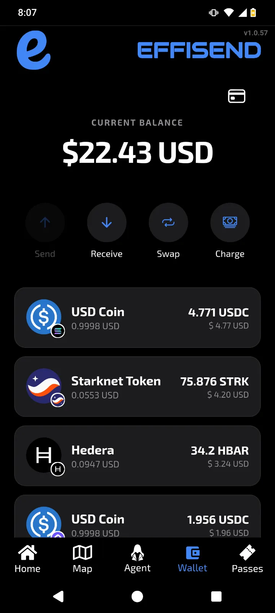 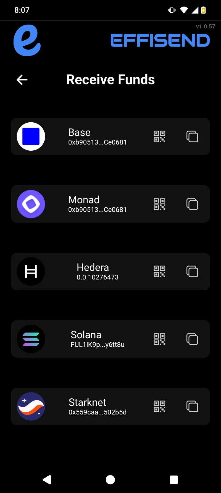 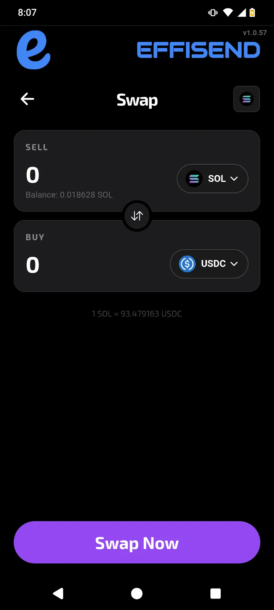

### Wallet Services Diagram:

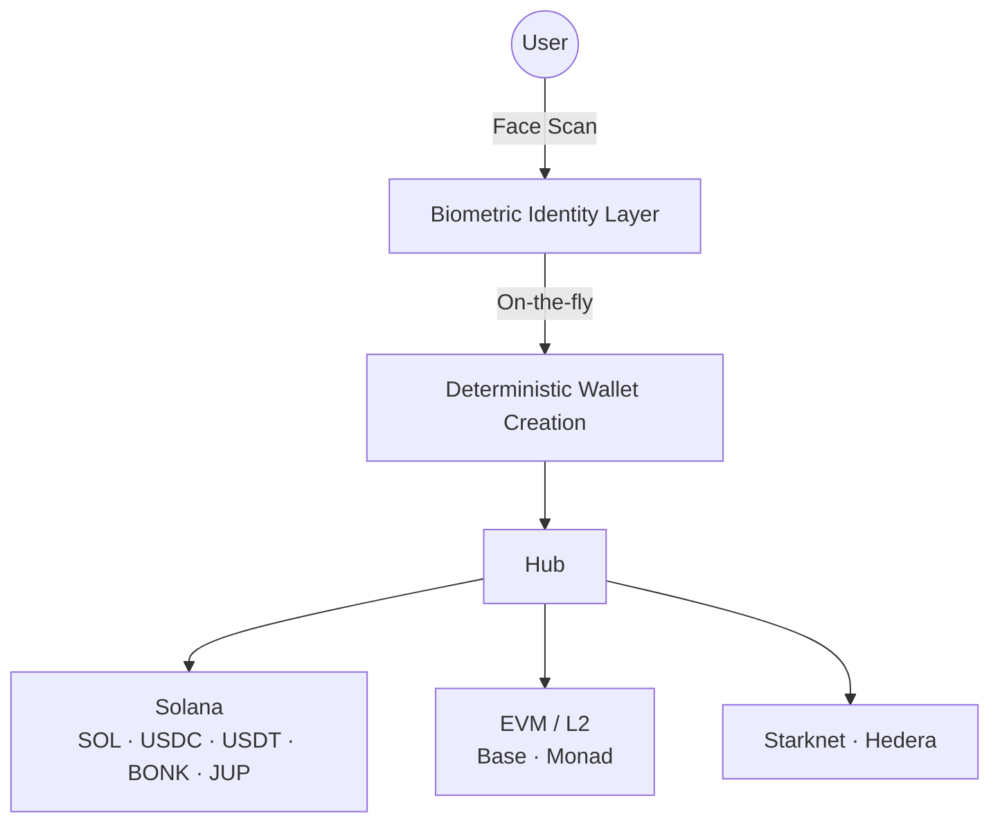

### 2. Information Services (Venue Ecosystem)
EffiSend provides deep, real-time data for high-traffic physical venues, ensuring users have everything they need at their fingertips.

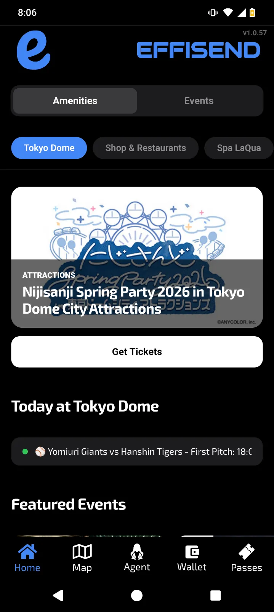 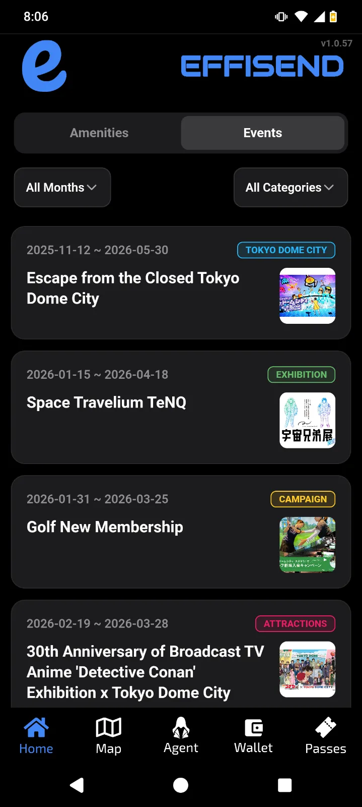 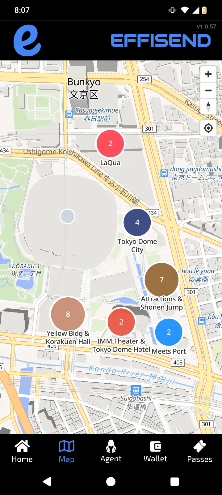

### Information Services Diagram:

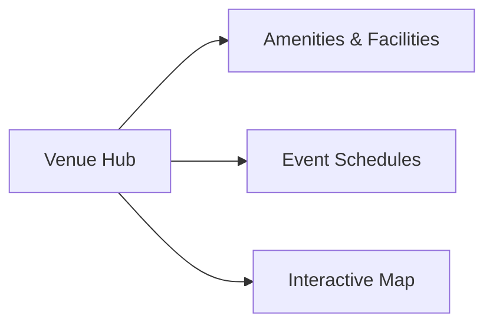

*   **Amenities & Events** — A comprehensive directory of venue facilities (restaurants, security, first aid) and dynamic event schedules.
*   **Interactive Map** — High-performance vector mapping with location-aware navigation to points of interest.

### 3. Agent Services (Intelligence & Execution)
DeSmond, the AI Concierge, translates natural language into complex venue and blockchain operations, acting as a single interface for all user needs.

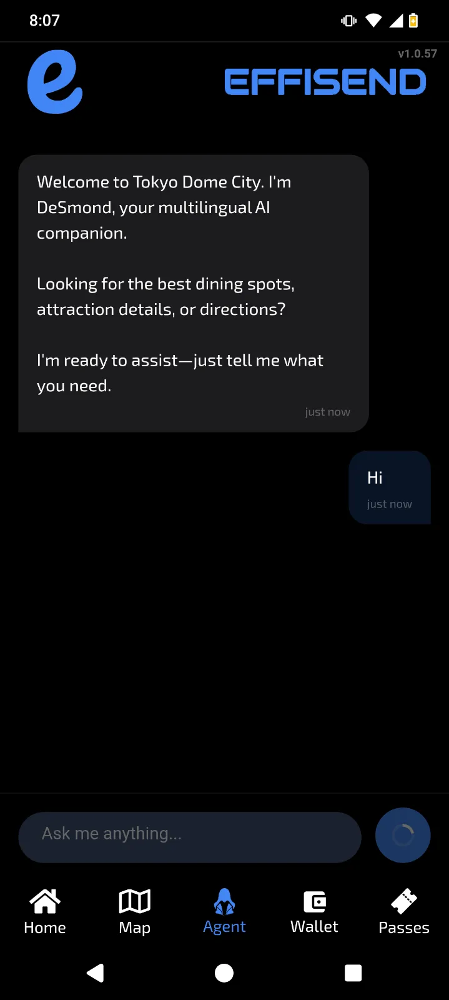 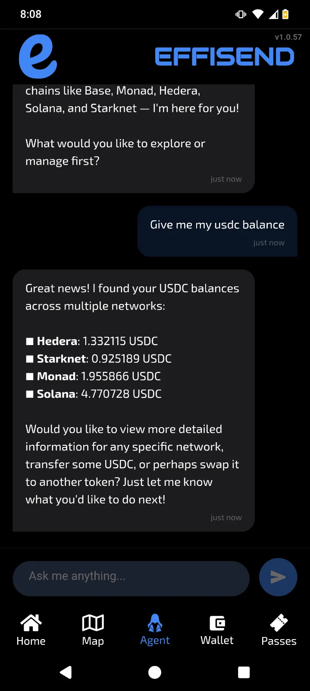 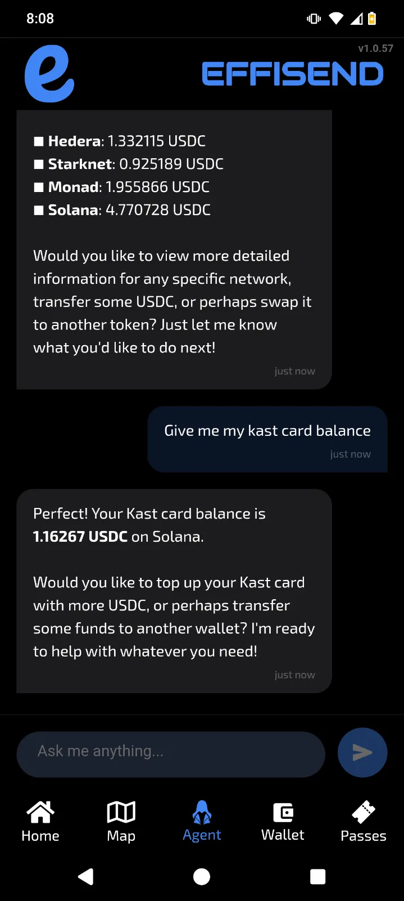

### Agent Services Diagram:

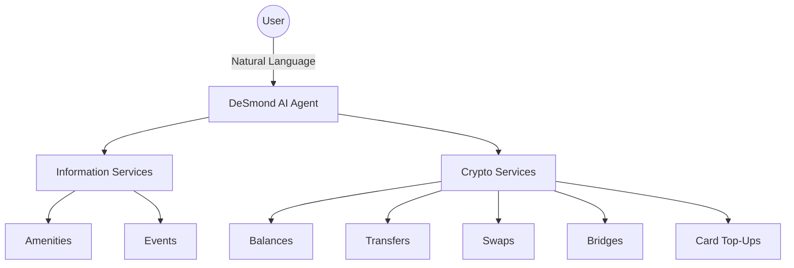

---

## Solana — The Primary Settlement Layer

Solana is not a secondary integration. It is the **heart of EffiSend's architecture** — chosen for its sub-second finality, negligible fees, and rich composable ecosystem.

### SPL Token Support

EffiSend natively manages the following Solana mainnet assets:

| Token | Mint Address | Decimals |
|-------|-------------|----------|
| **SOL** | Native | 9 |
| **USDC** | `EPjFWdd5AufqSSqeM2qN1xzybapC8G4wEGGkZwyTDt1v` | 6 |
| **USDT** | `Es9vMFrzaCERmJfrF4H2FYD4KCoNkY11McCe8BenwNYB` | 6 |
| **BONK** | `DezXAZ8z7PnrnRJjz3wXBoRgixCa6xjnB7YaB1pPB263` | 5 |
| **JUP** | `JUPyiwrYJFskUPiHa7hkeR8VUtAeFoSYbKedZNsDvCN` | 6 |
| **BTC (Wrapped)** | `3NZ9JMVBmGAqocybic2c7LQCJScmgsAZ6vQqTDzcqmJh` | 8 |

### Infrastructure

EffiSend uses **@solana/kit** and **@solana-program/token** in the app, and **Metaplex** for NFT metadata. Reads never depend on one endpoint:

*   **Browser first, server last.** The app asks keyless public RPCs directly, with a 5-second timeout per endpoint, and moves on silently when one hangs or refuses. Only when they all fail does it call the app's own server routes.
*   **Free RPCs before paid ones.** Server routes try free official endpoints first. Paid providers (Helius, Alchemy) have their keys only in the server environment and are used as a last resort.
*   **No keys in the app.** The browser bundle contains no provider keys. The wallet signs every transaction itself.


### Swaps — Jupiter on Solana

Swaps run in the `effisend-tdc-swap-tokens` Lambda, not in the app. For a Solana swap the Lambda asks **Jupiter Ultra** for an order first. If Ultra refuses the route, it falls back to Jupiter's classic quote and swap, where the wallet pays its own network fee. The Lambda only partially signs the transaction, and the user's wallet signs the rest.

Example: *"Swap 50 USDC for SOL"* → DeSmond resolves the tokens → Jupiter builds the route → the wallet signs → the result comes back in natural language.

---

## Solana integration: how it works today

This section describes the Solana code in the current Effisend TDC app (1.0.124). The source files are in [`solana/`](./solana), with the layout at the end of this section.

### Payments: Solana Pay that any wallet can confirm

DeSmond's payment QR is a Solana Pay *transaction request*. The wallet asks the server for an **unsigned** transfer that already carries a unique reference key, so the app can find the payment on-chain. The server holds no keys and cannot move funds.

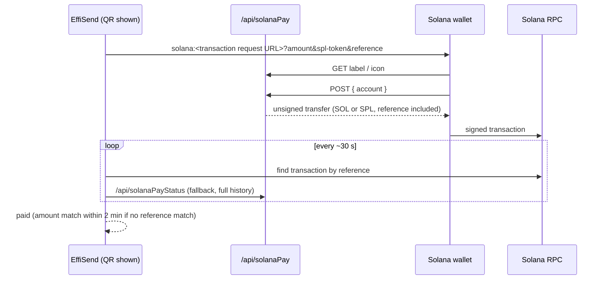

The reference lookup is exact. The amount match is only a fallback for wallets that drop the reference.

### Venue passes: Effi compressed NFTs

Effi passes are **compressed NFTs** in the Effi collection. Compressed NFTs are only visible through the DAS API, which public browser RPCs refuse, so the app asks its own server:

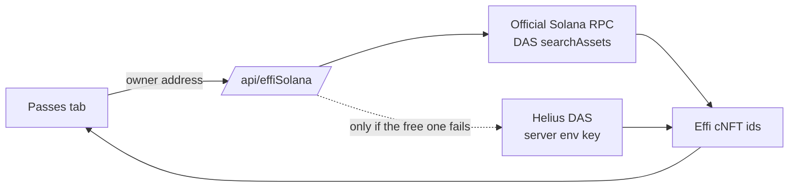

Standard NFTs in the wallet are listed differently: the browser reads the owner's token accounts and Metaplex metadata directly, and `/api/solanaNftMints` is used only when no browser RPC allows the scan.

### Balances and sends

*   **Balances** (SOL, USDC, USDT, BONK, BTC, JUP) come from the browser RPC race, with `/api/balances` as the server fallback. A failed read is shown as unknown, never as zero.
*   **Sends** check the address format, keep a **0.001 SOL** reserve for network fees, and accept `solana:` wallet URIs, keeping only the recipient.

### Cross-chain: USDC over Circle CCTP

Solana is one of the Circle Bridge Kit (CCTP) chains. USDC moves to and from Base, Arbitrum, Monad and Arc by burn-and-mint, so no wrapped token is created. The bridge screen checks that the wallet holds enough SOL for the fees before it quotes a route.

### Effi collection minting

`effisend-nft-solana` creates the Effi collection as **compressed NFTs** (Metaplex Bubblegum V1) with a Token Metadata collection NFT. A depth-8 Merkle tree holds 256 leaves, and each pass costs one transaction fee instead of the rent of a regular NFT (~0.0074 SOL). The operator key is KMS-encrypted and never leaves the function.

### Configuration

Names only; values live in the hosting and Lambda environments, never in the repo:

| Name | Used by | Purpose |
|------|---------|---------|
| `HELIUS_DAS_RPC_URL` | `/api/effiSolana`, server RPC fallback | Paid last-resort RPC and DAS lookup |
| `ALCHEMY_API_KEY` | server RPC fallback, `nft-solana` Lambda | Paid last-resort RPC |
| `JUPYTER_SWAP_API_KEY` | `swap-tokens` Lambda | Jupiter API key |
| `SOLANA_RPC`, `SOLANA_SEND_RPC` | `nft-solana` Lambda | Official RPC endpoints |
| `SOL_COLLECTION_MINT`, `SOL_MERKLE_TREE` | `nft-solana` Lambda | Effi collection and tree |

### Layout of `solana/`

```
solana/
  app/
    classes/solanaChain.js                 balances, NFT listing, Metaplex metadata
    core/solanaPayDetect.js                Solana Pay URL parsing and payment detection
    components/SolanaPaymentWidget.js      the QR and live payment status
    api/solanaPay+api.js                   builds the unsigned Solana Pay transfer
    api/solanaPayStatus+api.js             server-side payment detection
    api/solanaNftMints+api.js              fallback NFT listing
    api/effiSolana+api.js                  Effi cNFT lookup (DAS)
  lambdas/
    swap-tokens/                           Jupiter Ultra and classic swaps
    nft-solana/                            Effi collection and cNFT minting
    effi-solana-read/                      public read-only Effi lookup (earlier direct path;
                                           the app currently uses api/effiSolana)
```

These files are a reference copy. They import helpers from the full app, so they do not run on their own. The `.env` files, tests and dependencies are not included.

---

## Solana Mobile & Distribution Hub

EffiSend is optimized for the **Solana Seeker**, leveraging the world's most advanced web3 mobile hardware to bring agentic payments to the palm of your hand.

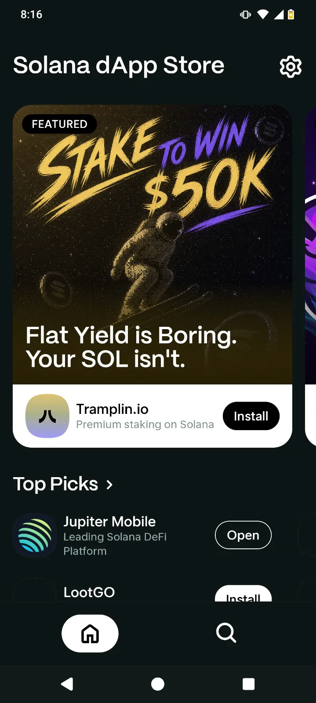 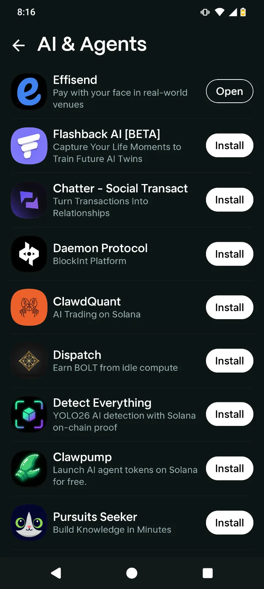 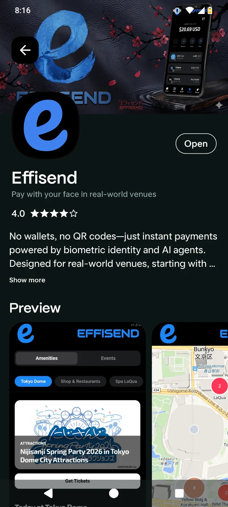

*   **Solana dApp Store Distribution** — By launching on the Solana dApp Store, EffiSend bypasses traditional gatekeepers, reaching a global audience of crypto-native users with zero censorship and a web3-first experience.
*   **Seeker-Native Integration** — Designed to feel at home on the Solana Seeker, ensuring that face-to-face payments and AI-guided operations are fluid, fast, and hardware-secured.
*   **Mass Distribution Strategy** — Our presence in the Solana ecosystem acts as a multiplier, allowing EffiSend to scale across physical venues worldwide by tapping into the existing community of Solana mobile users.

---

## Biometric Identity — The Face Layer

This is the most important innovation in EffiSend. There are **no seed phrases**. There are **no browser extensions**. There are **no hardware wallets**. Your face is your key.

### Wallet Onboarding

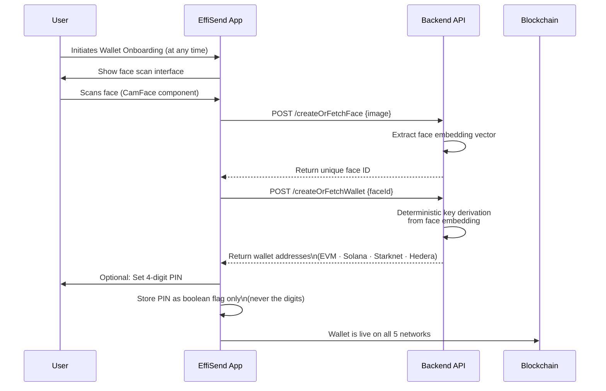

- **Deterministic:** Same face → same wallet, every time. Account recovery is just a re-scan.
- **Non-custodial by design:** Keys are derived from the face embedding — the backend cannot arbitrarily generate them.
- **Hardware-Backed Security:** All sensitive data (including the biometric login flag) is stored in the device's **SecureStore** (encrypted on-device).
- **Brute-Force Protection:** A 3-attempt PIN lockout automatically resets the session, forcing a biometric re-scan to continue.

### The "Face-to-Pay" Experience
 
 This is where EffiSend's power becomes tangible. A merchant shows a USD amount; a customer pays in any token, on any chain, using only their face.
 
 ```mermaid
 sequenceDiagram
    participant M as Merchant Terminal
    participant C as Customer (FaceID)
    participant W as  Wallet

    M->>C: Scan Customer Face
    C->>W: Instant Identity & Balance Resolution
    W->>M: Show eligible tokens across 5 chains
    C->>M: Selects Token (e.g. Solana USDC)
    W->>M: Transaction Signed & Confirmed
    M-->>C: Payment Success ✅
```

**The EffiSend Advantage:**
*   **Intelligent Liquidity Filtering** — Only tokens with sufficient balance are shown, eliminating payment failures.
*   **Parallel Execution** — All 5 blockchains are queried simultaneously; payment resolution happens in milliseconds.
*   **Zero-Touch Interaction** — The customer never touches the merchant's device; identity is verified purely through biometrics.
*   **Flexible Security** — Optional PIN layer for high-value transactions with built-in brute-force protection.

---

## DeSmond — AI Concierge for People and Payments

DeSmond is a proactive, **fully multilingual** AI agent embedded in EffiSend. It automatically detects your language and responds in kind while keeping proper nouns accurate. It covers two distinct domains through a single natural language interface.

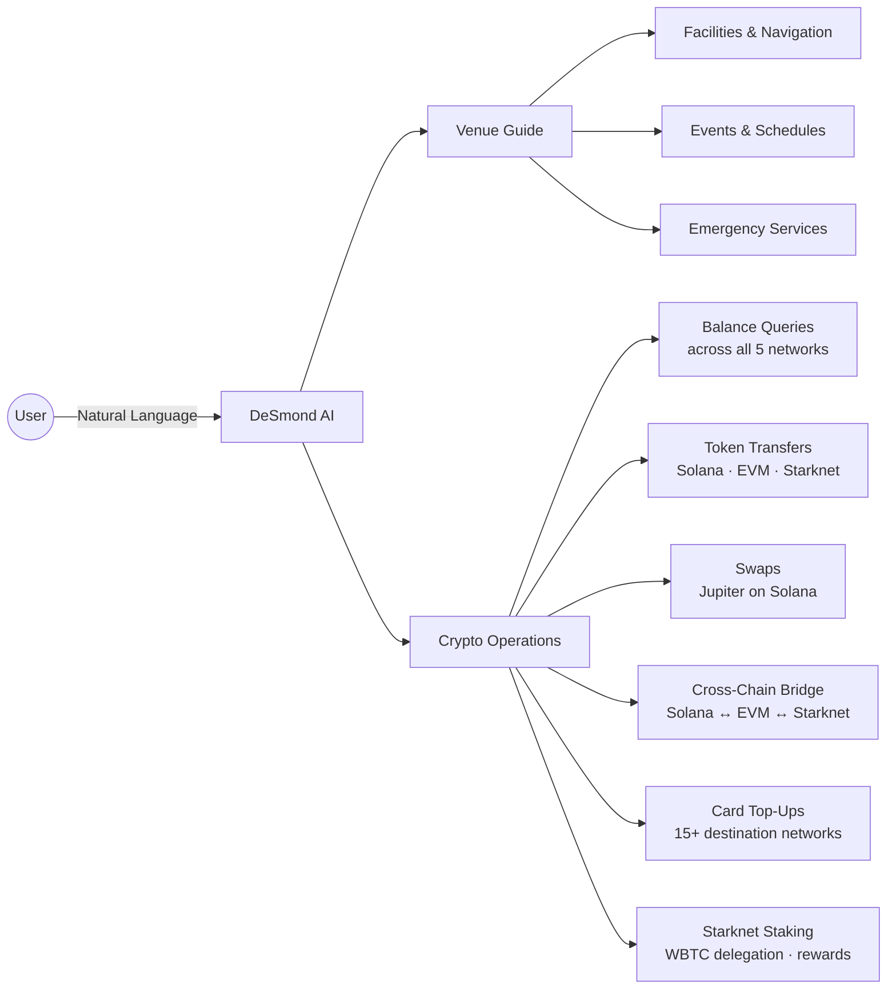

### Venue Guide Capabilities
- **Facility Discovery:** Find restaurants, pharmacies, ATMs, first aid within the venue
- **Event Scheduling:** Real-time schedules for concerts, games, seasonal events
- **Spatial Intelligence:** Walking distances between gates, nearest exits, station access
- **Emergency Access:** Instant location of security, lost & found, medical services

### Solana-Focused Crypto Examples

**Check your full Solana balance:**
> *"How much SOL and USDC do I have?"*  
> DeSmond reads your Solana wallet and returns all token balances in your language.

**Swap on Solana via Jupiter:**
> *"Swap 50 USDC for SOL"*  
> DeSmond routes through Jupiter, finds the optimal path, executes, and confirms.

**Bridge from Solana:**
> *"Bridge 100 USDC from Solana to Base"*  
> DeSmond calculates the bridge fee, selects LI.FI or LayerSwap, and executes — no UI navigation required.

**View your Solana NFTs:**
> *"Show me my NFTs on Solana"*  
> DeSmond resolves all Metaplex metadata from your wallet and describes your collection.

**Fund a card from Solana:**
> *"Top up my Kast card with 50 USDC from my Solana wallet"*  
> DeSmond validates the card alias, routes through the bridge if needed, and confirms the top-up.

> [!NOTE]
> DeSmond communicates exclusively in natural language — no code, no addresses, no chain selectors. It handles all technical routing internally and surfaces only what the user needs to confirm.

---

## NFT & Pass Gallery — Collectibles

The gallery aggregates digital assets from three chains into a single categorized view:

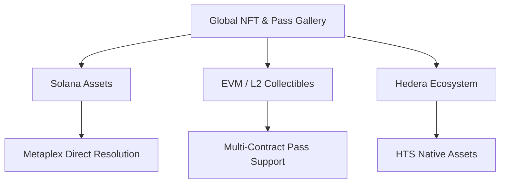

Each NFT card displays: chain badge, asset image, collection name, contract address. Tapping opens a full detail modal. Pull-to-refresh updates the gallery with a 30-second smart cooldown to minimize RPC load.

---

## Unified Liquidity Hub (Tab 4)

EffiSend's main dashboard provides a single source of truth for your net worth, combining real-time pricing with deep liquidity management.

*   **Real-time USD Tracking** — Instant valuation of all SOL, SPL, and cross-chain tokens powered by the CoinGecko API.
*   **Intelligent Balance Polling** — 30-second auto-refresh ensures you always see accurate liquidity before making a payment.

### Crypto Card Management

Register and fund external crypto cards (Metamask, Kast, Bitrefill) directly from your Solana balance. The "Add Card" interface handles the heavy lifting:

1.  **Identity:** Give your card a unique alias.
2.  **Network Routing:** Select the destination network (Linea, Base, Solana, Monad, Starknet, and 10+ others).
3.  **Token Selection:** Choose your preferred funding stablecoin (USDC or USDT).
4.  **Network-Aware Validation:** The UI performs real-time address verification based on the selected chain (checksums for EVM, regex for Solana/Starknet) before allowing the card to be saved.

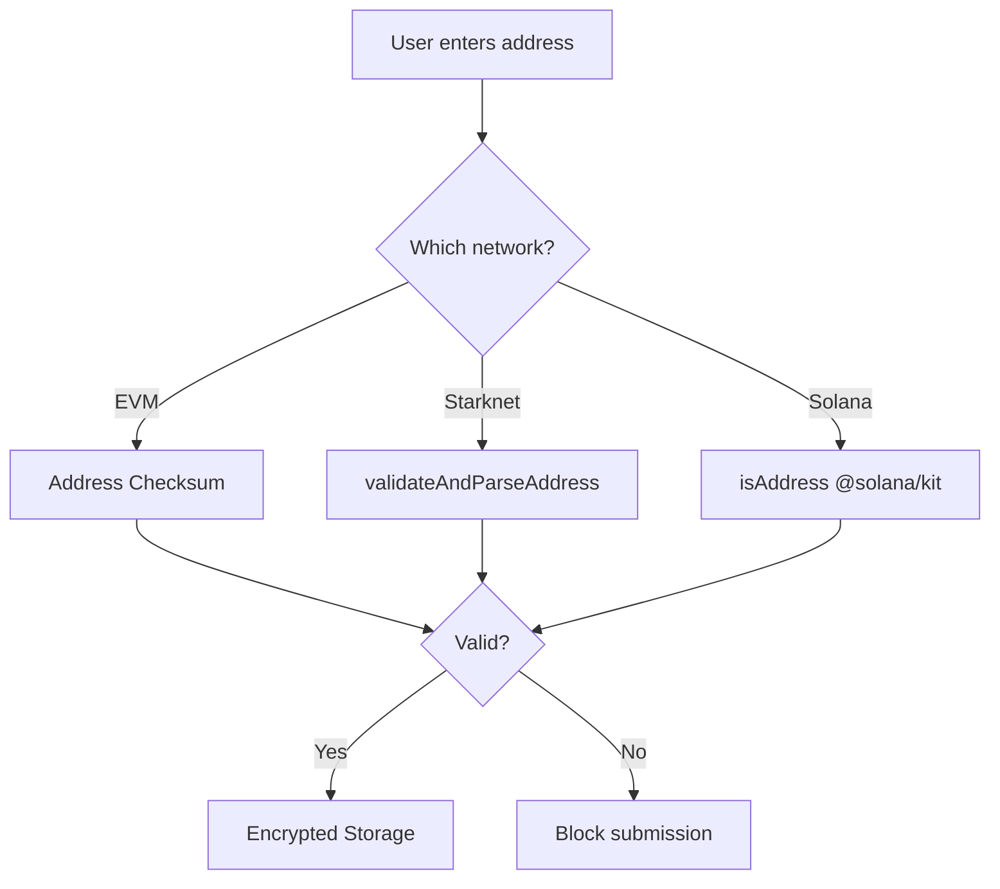

---

